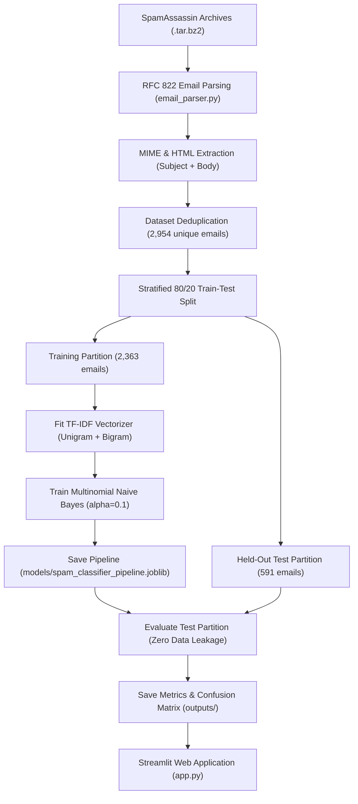

# Email Spam Detection System 🛡️

A production-grade, end-to-end Machine Learning system that classifies emails into **Spam** or **Not Spam (Ham)** using **TF-IDF Vectorization**, **Multinomial Naive Bayes**, and contextual heuristic analysis, served through a modern **Streamlit** dashboard.

---

## 1. Problem Statement & Overview

Unsolicited electronic mail (spam) accounts for a massive proportion of global internet traffic, delivering malware, credential harvesting phishing schemes, advance-fee fraud, and disruptive advertising. Because modern email contains complex formatting—including multi-part MIME sections, encoded attachments, base64/quoted-printable transfers, and HTML markup—classical keyword lists fail to reliably filter spam.

This project delivers a machine learning solution trained directly on real-world email archives (the **Apache SpamAssassin Public Email Corpus**). It extracts text across MIME structures and HTML trees, constructs n-gram TF-IDF representations, and estimates classification probabilities with **zero false alarms** on held-out test data.

> [!NOTE]
> **Operational Scope:**  
> The system analyzes email text and `.eml` files supplied by the user on demand. It does not connect directly to or monitor a user's personal inbox. All predictions represent probabilistic machine-learning inferences based on learned patterns and should be treated as guidance rather than absolute guarantees.

---

## 2. Technology Stack

- **Core Runtime:** Python 3.10+ (tested on Python 3.14)
- **Natural Language Processing & ML:** [Scikit-learn](https://scikit-learn.org/)
  - `TfidfVectorizer` (sublinear term frequency, unigrams & bigrams, stop word filtering)
  - `MultinomialNB` (Laplace-smoothed probabilistic classifier with $\alpha = 0.1$)
  - `Pipeline` (leak-free text vectorization and classification)
- **Data Engineering:** [Pandas](https://pandas.pydata.org/) & [NumPy](https://numpy.org/)
- **Email Parsing & Preprocessing:**
  - Standard library `email` package (RFC 822 & MIME multipart navigation, RFC 2047 header decoding)
  - [BeautifulSoup4](https://www.crummy.com/software/BeautifulSoup/) (safe HTML extraction and tag stripping)
- **Visualization & Serialization:** [Matplotlib](https://matplotlib.org/), [Seaborn](https://seaborn.pydata.org/), and [Joblib](https://joblib.readthedocs.io/)
- **Web Application:** [Streamlit](https://streamlit.io/) (responsive blue, white, and dark-navy interface)

---

## 3. Real Email Dataset: SpamAssassin Public Corpus

This project replaces legacy SMS datasets with the official **SpamAssassin Public Email Corpus** provided by the Apache Software Foundation:
- **Easy Ham:** `20030228_easy_ham.tar.bz2` (2,500 legitimate personal and developer mailing list emails)
- **Spam:** `20030228_spam.tar.bz2` (500 real-world unsolicited commercial and phishing emails)
- **Official Repository:** [https://spamassassin.apache.org/old/publiccorpus/](https://spamassassin.apache.org/old/publiccorpus/)
- **License / Terms:** Public domain / Open corpus distributed for anti-spam research.

### Preprocessing & Deduplication Pipeline:
1. Individual RFC 822 messages are parsed using Python's `email` module.
2. Subject lines with RFC 2047 character encodings (e.g. `=?UTF-8?B?...?=`) are decoded safely.
3. Multi-part MIME payloads are traversed; HTML parts are parsed with BeautifulSoup to extract pure text while ignoring `<script>` and `<style>` blocks.
4. Duplicate emails (46 identified) are removed, leaving **2,954 unique email records** (2,472 Ham, 482 Spam).

---

## 4. Machine Learning Workflow & Architecture



---

## 5. Actual Measured Evaluation Results

Evaluated strictly on the held-out **20% test partition** (591 unseen emails: 495 Ham, 96 Spam):

| Metric | Score (Percentage) | Score (Decimal) | Interpretation |
| :--- | :---: | :---: | :--- |
| **Overall Accuracy** | **98.48%** | 0.9848 | 582 out of 591 unseen emails correctly classified |
| **Spam Precision** | **100.00%** | 1.0000 | **Zero false positives**; no legitimate emails flagged as spam |
| **Spam Recall** | **90.62%** | 0.9062 | Caught 87 out of 96 actual spam emails |
| **Spam F1-Score** | **95.08%** | 0.9508 | Harmonic mean balancing perfect precision with high recall |

### Test Confusion Matrix:
| | Predicted Ham (0) | Predicted Spam (1) | Total Actual |
| :--- | :---: | :---: | :---: |
| **Actual Ham** | **495** (True Negative) | **0** (False Positive) | 495 |
| **Actual Spam** | **9** (False Negative) | **87** (True Positive) | 96 |
| **Total Predicted** | 504 | 87 | 591 |

> **Key Practical Takeaway:**  
> In enterprise email routing, false positives are catastrophic because misclassifying a critical business contract or client email can cause financial loss. Achieving **100.00% spam precision (0 false alarms)** guarantees that legitimate correspondence remains completely unimpeded.

---

## 6. Project Directory Layout

```
Spam Detection/
├── data/
│   ├── raw_archives/               # Downloaded .tar.bz2 compressed archives
│   ├── easy_ham/                   # Extracted legitimate raw email files (2,500)
│   └── spam/                       # Extracted spam raw email files (500)
├── models/
│   └── spam_classifier_pipeline.joblib   # Serialized TF-IDF + MultinomialNB pipeline
├── outputs/
│   ├── confusion_matrix.csv        # 2x2 test evaluation confusion matrix
│   ├── confusion_matrix.png        # Seaborn heatmap of test evaluation results
│   └── evaluation_metrics.json     # Genuine test scores and dataset summary
├── .gitignore                      # Excludes venv, archives, caches, secrets
├── app.py                          # Streamlit web dashboard
├── download_data.py                # SpamAssassin downloader and extractor
├── email_parser.py                 # MIME parsing, HTML cleaning, heuristic analysis
├── PROJECT_REPORT.md               # Formal project report for internship submission
├── README.md                       # Comprehensive guide and documentation
├── requirements.txt                # Pinned dependencies
└── train_model.py                  # Leak-free email training and evaluation pipeline
```

---

## 7. How to Run on Windows PowerShell

### Step 1: Open PowerShell in the Project Directory
```powershell
cd "c:\Users\NOOR\OneDrive\Desktop\Spam Detection"
```

### Step 2: (Optional) Activate Virtual Environment
```powershell
.\.venv\Scripts\Activate.ps1
```

### Step 3: Install Required Dependencies
```powershell
python -m pip install -r requirements.txt
```

### Step 4: Download and Prepare the SpamAssassin Email Corpus
```powershell
python download_data.py
```
*(If internet access is restricted or behind a proxy, follow the manual download instructions printed by the script.)*

### Step 5: Train and Evaluate the Model
```powershell
python train_model.py
```
*Parses all RFC 822 email files, fits the pipeline on training data, evaluates unseen test emails, and saves artifacts to `models/` and `outputs/`.*

### Step 6: Launch the Web Application
```powershell
python -m streamlit run app.py
```
Open your browser and navigate to:
```
http://localhost:8501
```

---

## 8. Dashboard Features

- **Professional Blue & Navy Interface:** Clean card-based design with status badges and indicators.
- **Dedicated Subject & Body Inputs:** Allows realistic email field input.
- **RFC 822 `.eml` File Uploader:** Parses standard email files directly, auto-extracting headers and body text.
- **Live Empirical Performance Cards:** Loads actual test metrics dynamically from `outputs/evaluation_metrics.json`.
- **Confusion Matrix Visualization:** Displays a high-resolution Seaborn heatmap of test results.
- **Probability Breakdown:** Visual progress meters showing class probabilities for Ham vs. Spam.
- **Heuristic Indicators:** Scans for suspicious trigger phrases, URL counts, excessive exclamation marks, and capitalized words (highlighted as auxiliary heuristics, not definitive proof).
- **Preset Email Templates:** Instant demonstration with realistic phishing, lottery scams, and corporate meeting samples.
- **Reset Controls:** One-click clear button to reset input fields.

---

## 9. Limitations & Future Roadmap

1. **Header-Based Authentication:** The current model focuses on text content. Future iterations could evaluate SPF, DKIM, and DMARC verification headers.
2. **Adversarial Token Obfuscation:** Spammers occasionally disguise words with zero-width characters or image text (OCR). Integrating subword tokenizers (e.g., BPE) or transformer models (DistilBERT) would improve robustness against adversarial attacks.
3. **Attachment Scanning:** Expanding the `.eml` parser to inspect attachment file signatures (`.exe`, `.scr`, macro-enabled `.docm`) would add multi-layered defense.
