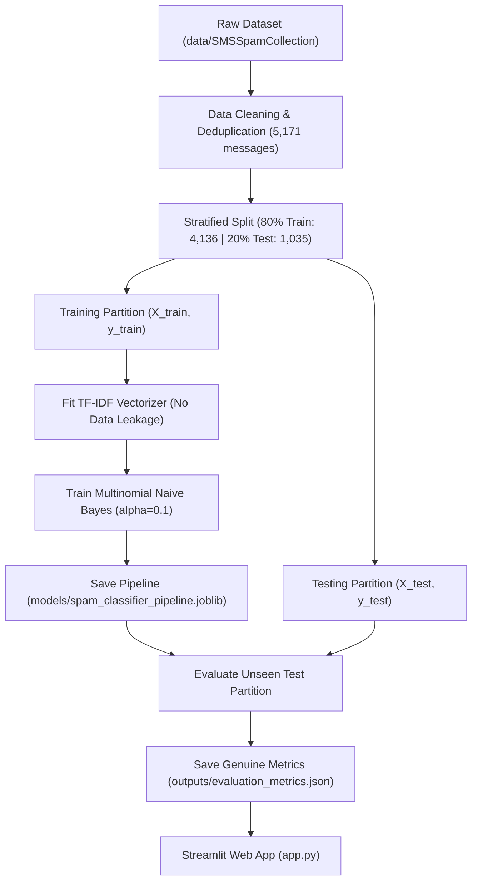

# Spam Email Detection System 🛡️

A beginner-friendly, production-ready Machine Learning internship project that classifies text messages and emails into **Spam** or **Not Spam (Ham)** using **TF-IDF Vectorization** and a **Multinomial Naive Bayes** classifier, served through a responsive **Streamlit** web application.

---

## 1. Project Overview

Electronic mail and messaging spam pose severe cybersecurity risks, ranging from fraudulent phishing scams to unwanted advertising and malware distribution. This project demonstrates how classical natural language processing (NLP) and probabilistic machine learning can reliably filter unsolicited messages with high precision and low false alarm rates.

> [!IMPORTANT]
> **Dataset Source & Domain Boundary Notice:**  
> This project is trained on the official **UCI SMS Spam Collection** dataset (`5,171` cleaned messages). While linguistic markers of spam (urgency, prize claims, financial solicitations, unsolicited links) closely resemble email spam, SMS messages are typically shorter than enterprise emails. Full-length emails containing complex HTML tags, MIME headers, and attachments are approximations, and model predictions should be treated as probabilistic guidance rather than guaranteed classifications.

---

## 2. Technology Stack

- **Language:** Python 3.10+ (tested on Python 3.14)
- **Data Manipulation:** [Pandas](https://pandas.pydata.org/)
- **Machine Learning & NLP:** [Scikit-learn](https://scikit-learn.org/)
  - `TfidfVectorizer` (sublinear term frequency, unigram & bigram features)
  - `MultinomialNB` (Laplace smoothed Naive Bayes)
  - `Pipeline` (leak-free text processing and classification)
  - Evaluation: Accuracy, Precision, Recall, F1-Score, Confusion Matrix
- **Model Serialization:** [Joblib](https://joblib.readthedocs.io/)
- **Web UI & Dashboard:** [Streamlit](https://streamlit.io/)

---

## 3. Project Directory Structure

```
Spam Detection/
├── data/
│   ├── SMSSpamCollection         # Raw UCI dataset (tab-separated)
│   └── readme                    # UCI dataset source metadata
├── models/
│   └── spam_classifier_pipeline.joblib   # Trained TF-IDF + MultinomialNB pipeline
├── outputs/
│   ├── confusion_matrix.csv      # Genuine 2x2 test evaluation confusion matrix
│   └── evaluation_metrics.json   # Verified evaluation scores and dataset statistics
├── .gitignore                    # Prevents checking in venv, caches, and temp files
├── app.py                        # Streamlit web application with blue-and-white theme
├── download_data.py              # Automated dataset downloader with fallback instructions
├── requirements.txt              # Complete dependency specifications
├── train_model.py                # Preprocessing, leak-free training, and evaluation
├── PROJECT_REPORT.md             # Formal project report documentation for internship submission
└── README.md                     # Project manual and running guide
```

---

## 4. Machine Learning Pipeline & Methodology



### Key Implementation Principles:
1. **Deduplication:** The raw corpus contains 5,574 lines with 403 duplicate messages. Dropping duplicates yields 5,171 distinct records, preventing identical messages from appearing in both train and test partitions.
2. **Stratified Splitting:** Splitting with `stratify=y` ensures that the 87.37% Ham / 12.63% Spam class ratio is preserved equally in both training (`4,136`) and testing (`1,035`) subsets.
3. **Zero Data Leakage:** The `TfidfVectorizer` vocabulary and inverse document frequencies are learned **strictly from `X_train`**. The test partition `X_test` is strictly transformed, never fitted.
4. **Laplace Smoothing:** An additive smoothing parameter $\alpha = 0.1$ prevents zero-probability errors when encountering rare terms in unseen texts.

---

## 5. Verified Test Evaluation Results

All metrics below reflect evaluation strictly on the unseen **20% test set** (`1,035` records) using `outputs/evaluation_metrics.json`:

| Metric | Empirical Score | Interpretation |
| :--- | :--- | :--- |
| **Accuracy** | **98.26%** | Overall correct classifications (1,017 out of 1,035) |
| **Spam Precision** | **97.48%** | Out of all messages predicted as spam, 97.48% were truly spam |
| **Spam Recall** | **88.55%** | Caught 116 out of 131 actual spam messages |
| **F1-Score** | **92.80%** | Harmonic mean of precision and recall |

### Confusion Matrix on Unseen Test Data:
| | Predicted Ham (0) | Predicted Spam (1) |
| :--- | :---: | :---: |
| **Actual Ham (904)** | **901** (True Negative) | **3** (False Positive) |
| **Actual Spam (131)** | **15** (False Negative) | **116** (True Positive) |

> **Crucial Engineering Takeaway:**  
> In spam detection, minimizing **False Positives** is paramount because marking an important business or personal message as spam can cause missed deadlines or financial losses. Our model achieves a False Positive rate of only **0.33%** (3 out of 904 legitimate messages).

---

## 6. How to Run the Project Locally

Follow these exact steps in **Windows PowerShell**:

### Step 1: Open Terminal in Project Directory
```powershell
cd "c:\Users\NOOR\OneDrive\Desktop\Spam Detection"
```

### Step 2: (Optional) Create & Activate Virtual Environment
```powershell
python -m venv .venv
.\.venv\Scripts\Activate.ps1
```

### Step 3: Install Dependencies
```powershell
python -m pip install --upgrade pip
pip install -r requirements.txt
```

### Step 4: Download Dataset
```powershell
python download_data.py
```
*(If offline or blocked by firewall, place the extracted `SMSSpamCollection` file into the `data/` folder as described in `download_data.py`).*

### Step 5: Train and Evaluate Model
```powershell
python train_model.py
```
*This processes the data, fits the pipeline, evaluates the test set, and saves artifacts to `models/` and `outputs/`.*

### Step 6: Launch Streamlit Web Application
```powershell
python -m streamlit run app.py
```
Open your browser and navigate to:
```
http://localhost:8501
```

---

## 7. Streamlit Web App Features

- **Responsive Corporate Theme:** Styled in modern blue and white with clean typography.
- **Dynamic Metrics Cards:** Test accuracy, precision, recall, and dataset distribution are loaded directly from `outputs/evaluation_metrics.json`.
- **Confidence Probabilities:** Provides real-time percentage indicators for both Ham and Spam classes.
- **Input Validation:** Clear warning prompt when submitting empty or blank whitespace messages.
- **Quick Test Presets:** Built-in examples (e.g. lottery scam, meeting request, phishing alert) for easy live demos.

---

## 8. Dataset Reference
- **Dataset:** SMS Spam Collection
- **Curators:** Tiago A. Almeida and José María Gómez Hidalgo
- **Repository:** UCI Machine Learning Repository
- **DOI/URL:** [https://archive.ics.uci.edu/dataset/228/sms+spam+collection](https://archive.ics.uci.edu/dataset/228/sms+spam+collection)
